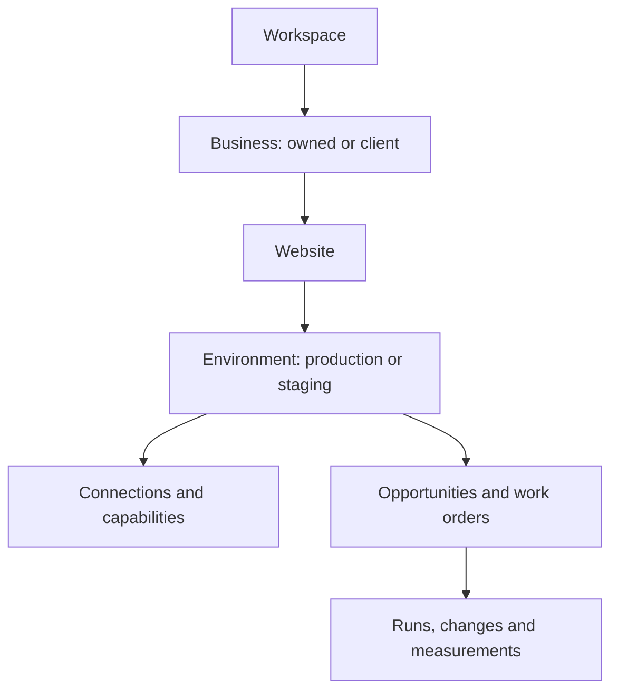
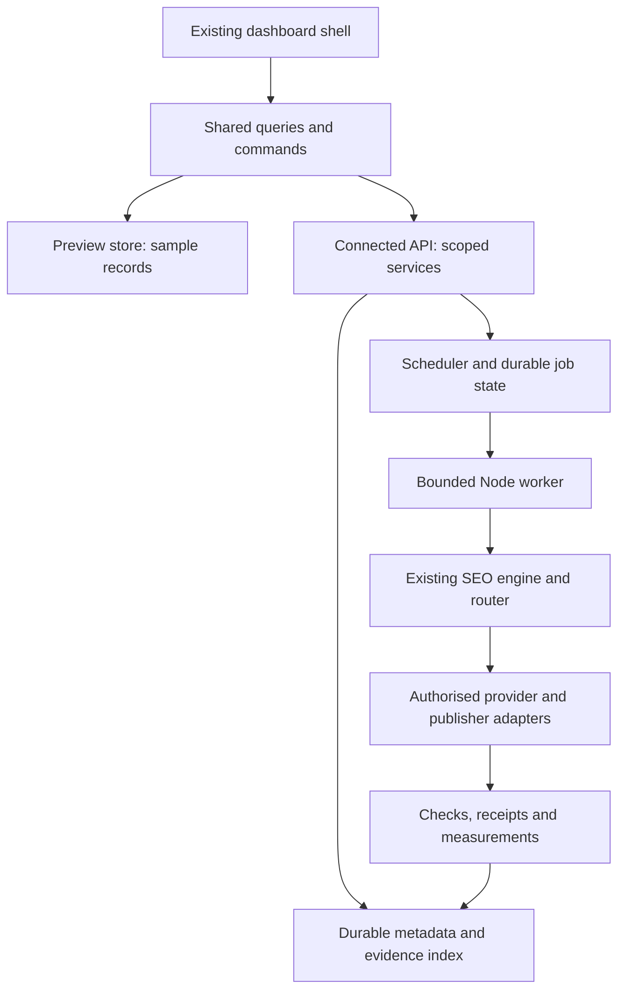

# SaaS workspace and SEO operations design

Date: 25 October 2026, Asia/Dhaka. **Proposed design, not implemented or deployed.**

Review: an independent builder check found no important unresolved planning questions. Visual selection, provider access and deployment choices remain explicitly deferred; this is not owner approval of the proposal.

Owner request: preserve the existing system, redesign the dashboard into a usable SaaS workspace, make the backend and agent responsibilities understandable, support adding own/client businesses and websites, and defer authentication during the preview stage. Name, colours and branding remain undecided. The immediate deliverable is this plan; no production redesign or backend deployment is claimed.

Audited main: `ac21a311753e8d7c6a39f3b48036203810f3f862`, v2.20.0. Existing work-evidence branch: `116a539b860eccdb4c9633bccee10c57d8caa3cf`, [PR #23](https://github.com/bishal-paul-git/seo-autopilot/pull/23). Both its code and subsequent documentation CI passed. Start with [STATUS](../../implementation/STATUS.md), the [live trace](../../implementation/LIVE-SYSTEM-TRACE-2026-10-25.md), [product brief](../../../SEO-PRODUCT-BUILD-BRIEF.md) and [current departments](../../../departments/README.md).

## 1. The product we are designing

An SEO operations platform where a business owner or agency connects a website, sees evidence-backed priorities, understands what the system is doing, controls what it may change and measures the result. The platform must cover technical SEO, research, content, authority and AI search, including local/ecommerce needs. It is not limited to articles, audit scores or an agent directory.

The first owner workspace contains both owned businesses and client businesses. This is one product and one engine. A future customer gets their own workspace using the same model. “Vendor” here means a user/business using the SaaS; there is no vendor marketplace, reseller system or extra hierarchy in this design.

Success for the first redesign: from the dashboard the owner can answer **which website needs attention, why, which specialist owns the work, what can happen next, what actually happened and what is still unverified**. Adding another website must be a visible onboarding flow, not a developer-only config exercise.

## 2. Approaches considered

| Approach | Benefit | Tradeoff / disposition |
|---|---|---|
| Reskin the current metrics snapshot | Quick visual change | Does not explain business structure, onboarding or execution. Insufficient on its own |
| **Restructure the current workspace around shared business/site/work contracts** | Preserves the engine and existing experience; preview can expose the future backend model | Needs careful mapping of current snapshots to records. **Recommended proposal** |
| Replace the interface and engine with a new hosted application | Maximum freedom | Duplicates existing work, obscures integration evidence and adds deployment risk. Rejected for this increment |

The owner has requested a SaaS redesign and a plan, but has not selected a visual concept or approved every technical proposal below. Recommendations are identified as such; they are not retroactive owner decisions.

## 3. Immediate scope: login-free structural preview

No login, registration, password reset, invitations or billing setup in the preview. Review the product structure before spending effort on those flows.

- Build the redesign from a typed data contract and a repository/store adapter, so all screens describe the same business/site/job/work records.
- The publicly reachable preview uses clearly labelled synthetic examples. Its add-business/add-website and state transitions operate in preview state and can be reset. No real credentials, customer reports or live mutations are attached to unauthenticated controls.
- Existing authorised CLI/Actions operation continues independently. Its execution/auth controls are not removed. Current live data is not silently migrated, erased or exposed more widely.
- Separate `preview` from `connected` mode in the data contract and configuration. The preview provider must be excluded from connected production reads and writes; neither mode can silently fall back to the other.
- Backend design is substantive: records, relationships, capabilities, API/service boundaries and lifecycle rules are specified before decorative screens. A browser-only preview does not prove that a hosted backend exists.
- Login-free does not mean implementing public control endpoints against private customer sites. Secure connection and execution access is a later activation milestone, not a login gate added to this preview.

This is a redesign of the existing product. The live source/build/upload path is still unverified. Map it before editing/deploying there. If that remains blocked, present the proposal and visual concepts from this repository; do not ship a second operational dashboard or overwrite Hostinger with an unrelated template.

## 4. Shared business model

| Object | Meaning / rules |
|---|---|
| Workspace | Account boundary for one solo owner, company or agency; plan and usage eventually belong here |
| Business | Company/brand being served; `relationship: owned | client`. Same workflow and records for both |
| Website | Domain/site managed for a business; one business can have several websites |
| Environment | Destination and connection bindings for staging/production; default production, staging optional |
| Connection | A provider account/installation credential reference, never the credential itself in browser data |
| Property binding | Explicit website/environment → Google property, repository or CMS destination mapping; verified separately |
| Opportunity | Evidence-backed finding and proposed outcome; not already an approved/queued action |
| Work order | Bounded responsibility with goal, scope, specialist, dependencies, checks, budget and policy |
| Run / attempt | Actual deterministic job or model execution, with input/output references and recorded status |
| Change set | Specific proposed change tied to destination and revision; separate from generating a draft |
| Publication receipt | External PR/merge/CMS/deploy evidence with verification; not inferred from work being done |
| Measurement | Dated baseline/follow-up tied to a change and property; can be pending or inconclusive |

Use stable IDs, not display names or array positions, for relationships and routing. Keep engine site IDs as imported identifiers; they are not globally unique tenant IDs. The existing `scope: pages | site` is the change scope, separate from workspace/business/website ownership.

## 5. Frontend information architecture

Use one application shell with a workspace/business/site switcher. Scope is visible in the page heading and filters. Global and site views reuse components and queries rather than becoming two different dashboards.

### Workspace navigation

| Area | What the owner sees / does |
|---|---|
| Overview | Websites needing attention, blocked work, recent verified changes, spend and connection freshness |
| Businesses & websites | Owned/client labels, website status, goals, responsible person; add business or website |
| Work | Cross-site queue: queued, running, needs review, completed, failed; filter by business/site/specialist |
| SEO system | Coverage map, departments, specialist responsibilities, workflows and actual execution evidence |
| Connections | Provider account connections and affected websites; permissions, health and reconnect state |
| Settings | Workspace preferences and eventual plan/usage controls; no functioning billing flow in preview |

### Selected-website navigation

| Area | Questions it answers |
|---|---|
| Overview | What matters now? What ran recently? Is evidence fresh? What is blocked? |
| Work | What is queued/running/waiting for review? Open a work-order detail and timeline |
| Opportunities | Why act on this? Show evidence, affected pages, expected benefit, confidence and dependencies |
| Content | Existing-page map, briefs, drafts, refreshes and schedule; link each item to its work order |
| Results | Search traffic, queries, pages, locations, conversions where connected, dated change history and follow-up |
| Settings | Site facts/goals, market/language, connections, destination, budgets, autonomy and pause |

Keep familiar paths reachable. Overview remains Overview. Traffic/Keywords/Pages/Locations move under Results. Coming next becomes Work/Opportunities, not a discarded plan. Weekly report remains a dated report under Results. SEO team becomes the site-filtered SEO system view. Preserve old deep links with route aliases after the real router is located.

### Layout and detail patterns

- Left rail for stable navigation; top bar for workspace/site scope, source date, mode and Add website.
- Overview: short priority list, recent work and connection health first; charts underneath. Avoid a page of arbitrary scores.
- Work: status filters and a useful table by default; optional board. One click opens a detail drawer, with a full-page permalink for long evidence.
- Work detail: goal/why → evidence → owner/scope → dependencies → plan/change → checks → attempts/cost → publication → follow-up.
- Results: metric definitions, source window and comparison window; no apparent daily chart built from rolling-28-day totals.
- Empty states explain the next step. Missing Google access says “Connect Search Console”; low traffic says “Not enough data”; preview examples say “Preview data”.
- Responsive: scope selector and primary action stay reachable; tables collapse to readable rows; system map has an accessible list alternative. Status always has text, not colour alone.

## 6. Make the SEO engine understandable

Show a real **SEO system** screen with two related views:

1. **Coverage:** the areas the system supports, their inputs, checks and applicable specialist packs.
2. **Operations:** the work orders and actual runs for this site, including blockers and outcomes.

The default should be the understandable coverage/workflow view, not a busy animated graph. A graph is an optional drill-down for dependencies.

| Existing department | Responsibility | Reused engine examples | Customer-facing output |
|---|---|---|---|
| Command | Profile, strategy, prioritisation, coordination and reporting | `profile`, `priorities`, `team`, `monthly` | Goals, ranked plan, assignments and progress |
| Research | Demand, competitors, intent and opportunity evidence | `keywords`, `rank`, `gap`, `deepdive` | Keyword/page opportunities with sources |
| Technical | Crawlability, indexing, rendering, speed and structured data | `audit`, `gsc`, `render`, `speed`, `schema`, `redirects`, `logs` | Findings and scoped technical change requests |
| Content | Briefs, drafts, snippets, links and refreshes | `propose`, `refresh`, `optimize`, `links`; existing draft workflows | Briefs, drafts, diffs and schedule |
| Quality | Factual, editorial, sensitive-topic and deterministic validation | `facts`, `quality`, `ymyl`; reviewer/check workflows | Per-revision pass/fail and review requirements |
| Authority | Link/mention evidence, entity signals and reputation | `authority`, `inbound`, `mentions`, `entity` | Opportunities/advice; outreach remains review-controlled |
| AI search | Readiness and measured visibility/citations | `geo`, `ai-visibility`, `citations` | Dated prompt/provider evidence, readiness and uncertainty |
| Verticals | Applicable local business and ecommerce expertise | Pack registry, `local`, `shop`, `listings` | Site-specific coverage and specialist findings |

This table maps responsibilities to existing jobs; it does not assert that every definition executes autonomously or that every external integration is verified.

Each specialist detail shows: role, inputs, assigned work, allowed tools/actions, validation partners, last actual run, latest output and usage. Capability badges are independent: **definition available**, **connection verified**, **assignment planned**, **attempt recorded**, **output validated**, **publication verified**, **monitoring pending/recorded**. A routed plan never increments “completed work”. Deterministic runs are labelled as code; no model call is required just to make an agent appear active.

Keep the 38 definitions, eight departments, seven shared skills and deterministic router. Do not make 38 separate always-on services. Display unavailable areas with their missing input or access; do not create new agents for presentation symmetry.

## 7. Adding another website: SaaS onboarding journey

| Step | User action | Backend responsibility / result |
|---|---|---|
| 1. Business | Select an existing business or Add business; choose owned/client | Create/reuse business ID; prevent accidental duplicate website setup |
| 2. Website | Enter canonical URL, confirm intended scope and authority to connect | Normalise URL, discover platform/sitemap, suggest variants for confirmation; domain detection alone is not ownership verification |
| 3. Goals | Choose lead generation, sales, local visibility or content growth; set market/language | Store site profile, target audience, confirmed business facts, exclusions and optional applicable packs |
| 4. Data | Connect Search Console; optionally GA4 and other useful sources; select property | Server-side consent/credentials later, explicit bindings and permission/health check; public-audit-only mode may proceed without Google |
| 5. Execution | Connect GitHub/source or a verified CMS destination if changes are wanted | Decide edit vs advise mode; distinguish detection, read access, draft ability and verified publishing capability |
| 6. Policy | Choose observe, prepare or configured automation; set frequency, spend limits and pause | Show effective D17 policy and human-only classes; no automatic publishing merely from adding the URL |
| 7. Baseline | Review the first collection/audit and missing inputs | Create dated run/evidence records; show meaningful partial success, quota/errors and unavailable metrics |
| 8. First work | Choose an opportunity, inspect proposed work and enable the agreed operating policy | Reuse router/work orders; make the first work order traceable through checks, publication and follow-up |

In the no-auth preview these are representative interactions only: simulate connection states explicitly, persist sample setup locally, and never claim Google/GitHub was connected. In connected operation provider consent and property permissions are real steps even though product login was deferred during design.

Existing sites get an **import/reconcile** path, not “add again”: identify the authorised repository config and saved state, map site ID/URL to the correct business, show a preview of records to import, keep source references and timestamps, and deduplicate by source identity. Do not replace schedules, credentials or autonomy defaults during import.

Google or a publisher being disconnected must not block basic authorised public-site diagnosis. The current config validator requires a Search Console property; the onboarding adapter must distinguish a suggested property string from verified access, and collection jobs requiring Google remain disabled until verification. No guessed property is represented as connected.

Website connection states: setup → baseline pending → observing → preparing → automation enabled, with independent needs-attention/paused/disconnected flags. Never use a single “Live” badge to mean that every capability works.

## 8. Backend structure and reuse

### Boundaries

- **Presentation:** the traced existing dashboard shell and navigation. Styling changes do not contain business rules.
- **Application services:** business/site management, connection health/binding, opportunity conversion, work commands, policy and result queries. Scope and action checks live here.
- **Execution:** a worker invokes existing jobs through `src/jobs/index.mjs`/the CLI, with bounded inputs and an isolated site workspace. No SEO rewrite inside frontend code. The current Cloudflare MCP connector remains a separate read-only integration, not the queue or executor.
- **Persistence:** retain repository state for current CLI installs. Proposed hosted destination is one Postgres metadata store, compatible with Supabase, plus object/report storage. No new database project or billable service is created by this plan. Confirm the hosting/runtime and actual UI stack after tracing the live source; D13's earlier TanStack proposal is not a reason to replace that source.
- **Providers:** use the existing Google/data/publisher modules behind services; credentials and refresh remain server-only. Vendor/account IDs must be explicitly bound to the website/environment.

Reuse `src/analysis/agent-router.mjs`, `work-orders.mjs`, `autonomy.mjs`, `src/core/work-state.mjs`, `src/core/collect.mjs`, `departments/`, current Actions templates and verification logic. Add adapters around them. The existing single-site Supabase ingest example is not a tenant-safe hosted schema.

### Proposed durable records

| Group | Records / critical fields |
|---|---|
| Structure | workspaces, businesses, websites, environments; stable IDs and ownership chain |
| Site knowledge | goals, market/language, confirmed facts, exclusions, content/source paths and pack selection |
| Connections | provider accounts, encrypted credential references, bindings, scopes, last check and errors |
| Evidence | runs, report references, findings/opportunities; source timestamp/window, engine version, input hash and evidence type |
| Work | work orders, dependencies/target locks, attempts; goal, specialist, allowed actions, policy, max spend, status and failure details |
| Content / changes | briefs, drafts, versioned change sets, validation records and revision-bound approvals/policy decisions |
| Publication | destination, operation, idempotency key, external receipt, verification time and rollback eligibility |
| Results | baseline/follow-up windows, control references where available, outcomes and uncertainty |
| Operations | usage events/reservations, notifications and append-only audit events; memberships/roles when connected customer access is activated |

All hosted records carry workspace ownership, including derived worker records. Composite ownership checks prevent a job/connection being attached to another workspace's site. A one-workspace preview uses this shape without requiring user login. It is not proof of cross-customer isolation.

### Example service contracts, not implemented endpoints

`listBusinesses`, `addBusiness`, `addWebsite`, `getWebsiteOverview`, `getCapabilities`, `listOpportunities`, `prepareWorkOrder`, `listWork`, `getWorkDetail`, `getConnectionHealth`, `getResults`, `setPolicy`, `pauseWebsite`.

Queries return one envelope with `mode`, `workspaceId`, `websiteId` where scoped, `source`, `sourceAt`, `collectedAt`, `engineVersion`, `verificationLevel` and `warnings`. Work commands accept explicit scope and an idempotency key; do not accept arbitrary shell, agent names without registry validation or a browser-supplied external destination as authority. Preview commands have no live side effects. Hosted command authorization is derived server-side when connected mode is activated.

### Work lifecycle and reliability

Use separate execution, validation, publication and monitoring states. “Done” is too ambiguous on its own.

- Execution: queued → running → succeeded/failed/cancelled, with blocked/paused/retry-wait states where needed.
- Validation: not run/pending/pass/fail, bound to the change revision and inputs.
- Publication: not requested/needs review/eligible/applying/verified/failed/rolled back, with receipt evidence.
- Monitoring: pending/collecting/complete/inconclusive/regression.

Adapt existing pending/running/done/failed states into this contract; do not reinterpret old operator records as trusted worker receipts. Preserve fingerprints and attempt history. Worker receipts additionally identify engine/agent version, inputs, output revision, start/end time and actual usage.

Scheduling, routing, quota/policy checks, duplicate prevention and state transitions are deterministic. AI handles bounded diagnosis, strategy and original drafting where useful. A model cannot grant itself permission, increase its budget or bypass validation. Paid jobs reserve budget before execution and reconcile actual usage afterward; timeout/retry spend counts toward the limit. Local file locks remain useful locally; distributed operation needs atomic claims, leases, heartbeats, target locks and retry backoff rather than sharing `work.lock` across machines.

D17 remains authoritative: eligible routine changes can publish after the configured exact-revision checks, limits and pause checks; sensitive topics, site-wide indexing, migrations, deletions, outreach and infrastructure require review. New SaaS onboarding starts in observe mode until the owner chooses a policy. Import does not reset existing policy. This proposal does not restore the older “every change always needs a person” wording found in historical D7/department design notes.

## 9. Brand and visual direction: candidates, not decisions

Keep **SEO Autopilot** as the working label. Do not create a new logo, rename packages/domains or treat earlier rejected names as selected. Product positioning proposal: **“Your SEO team, with the work and results in one place.”** Supporting promise: evidence-backed priorities, controlled execution and visible follow-up; never guaranteed rankings or AI recommendations.

| Direction | Palette proposal | UI character |
|---|---|---|
| **A — Clear operations (recommended)** | Warm white `#F8FAFC`, slate `#0F172A`, cobalt `#2563EB` | Light, crisp and readable; precise tables, restrained cards and clear evidence timelines |
| B — Calm growth | Ivory `#F7F6F2`, ink `#17211D`, teal `#0F766E` | Warmer service feel; approachable for business owners, still operational |
| C — Technical studio | White `#FAFAFA`, charcoal `#18181B`, violet `#6D28D9` | More product/engineering character; denser operation views and restrained accent |

These are design hypotheses, not colour selections or finished mocks. Use semantic tokens for surfaces, text, borders, brand accent and status, so switching direction does not alter behaviour. Status colours are separate from branding. Typography should be a legible sans with tabular numerals; final font/weights are chosen from real rendered alternatives, not a claim of an existing selected brand.

Next design output: three comparable visual concepts using the same Overview, SEO system and Add website flow, grounded in captured screenshots of the current interface. After a choice, refine desktop/mobile layouts and implement the chosen direction in the traced application. Do not confuse a visual concept with an operational backend.

## 10. Delivery sequence and acceptance gates

| Stage | Deliverable | Evidence to move on |
|---|---|---|
| 0. This proposal | Product hierarchy, source reuse map, onboarding, contracts and design choices | Owner can understand and correct the proposed structure; all recommendations marked proposed |
| 1. Source and visual selection | Trace current generator/deployment; capture existing UI; three design concepts | Reproducible source/revision identified before live edits; chosen visual direction recorded |
| 2. Login-free structural preview | Existing shell adapted; business/site switching, system coverage, Work detail and Add website journey | Interactive sample flows work across shared scoped records; preview label/reset; no live secrets/commands; old routes retained |
| 3. Backend foundation | Hosted records, scoped service/worker adapters, read-only import and connection checks | Restart persistence, idempotency, budget/pause behaviour and ownership tests; real/snapshot/sample data cannot be confused |
| 4. One connected operating cycle | Authorised site: evidence → opportunity → work → validated change → policy publication → follow-up | External receipts and dated measurements; duplicate retry, wrong destination, failed check and rollback tests; no website changes just for demonstration |
| 5. Customer activation | Authentication/membership enforcement, secure connections, notifications and usage controls | Two customer workspaces cannot read/mutate each other's records through UI/API/worker; offboarding and revocation work |
| 6. Commercial pilot | Measured costs, packaging, support workflow and paid-pilot proposition | A real completed cycle, cost per active site/action and owner/customer feedback; no invented pricing or success claims |

Stage 3 may use private operator access for existing authorised work; customer-facing connected operation cannot precede Stage 5's access gate. Dependency, framework and hosting choices remain bounded by the source trace. Do not buy services or deploy a new runtime just to satisfy this document.

## 11. Migration, open decisions and builder handoff

Migration: keep current CLI IDs, state branches, schedules, work history and D17 policy. Add non-destructive mappings to business/site/environment records; import snapshots with origin/date labels. Preserve current deep links and build a reviewable feature branch. Back up and document a rollback to the current artifact before a later Hostinger deployment. The current dashboard's data/access issues are recorded in the live trace; this plan does not silently fix or delete that deployment.

Open owner decisions after reviewing the structure: visual direction and typography; final product name; preferred default landing view (portfolio or selected website). Builder defaults proposed here: portfolio for multi-site users, selected website for a single-site user, Direction A for the first mock, no forced dependency on another product. Provider-specific access, prices, production deployment and customer publication remain separate decisions/evidence gates.

Next implementer entry point: read this proposal plus STATUS/DECISIONS, refresh main/PR #23, locate the live source, capture it and present visual concepts. Reuse existing code. Implement the selected preview within the current product; do not infer that writing this plan authorises a new repository, an unauthenticated live worker or customer content publication. Update the progress log with implemented/verified/deployed distinctions and exact commits after each increment.
